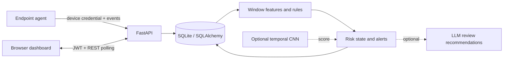

# LITDS — Lightweight AI-Based Insider Threat Detection System

A Computer Science final-year dissertation prototype by **Neer-1** for collecting endpoint activity, analyzing behavioral indicators, and reviewing alerts through a company-scoped dashboard. It is an academic monitoring and decision-support system, not a validated threat-prevention product.

**Release status:** candidate02, prepared for final publication authorization. The isolated dependency verification, 36 release checks, 18 regressions and runtime null-confidence assertion passed. Publication rights/licensing and explicit GitHub authorization remain for final review. No deployment, real-world detection accuracy, or autonomous containment is claimed.

## Implemented system

- Python endpoint agent: enrollment, local buffering, polling and activity collection. Included as source; never run against this computer during release preparation.
- FastAPI backend: company/owner/admin identities, JWT login, device approval, per-device credential ingestion and company-scoped reads/mutations.
- SQLAlchemy database: devices, events, window features, alerts, recommendations, risk components, department policies and snapshots. SQLite is the verified demo path; PostgreSQL compatibility is unverified here.
- Deterministic analysis: temporal feature aggregation, rule-based anomalies, behavioral baselines, weighted scores and per-signal rise/decay. Scores are heuristic priorities, not probabilities.
- Browser dashboard: same-origin REST polling, device/employee views, alerts, risk histories, admin review and report interfaces. There is no live-update WebSocket implementation in LITDS.
- Experimental temporal 1D CNN and Isolation Forest code; optional LLM narrative/recommendation, PDF report and SMTP modules. These optional integrations were not exercised in this release check.



## Safe local demo

Python 3.12.3 on Windows was used for verification. Other platforms are unverified.

`requirements.txt` contains the verified direct/server pins, including PyJWT 2.14.0 and python-multipart 0.0.31. It is not a complete transitive hash lock. Follow [INSTALLATION.md](INSTALLATION.md) for the exact 33-package server configuration and separately verified collector/test supplement. Official binary wheels were byte-hash verified in the isolated experiment; all checks used synthetic data.

After creating the environment and installing the exact configuration from that guide:

```powershell
Copy-Item .env.example .env
# Generate separate keys and paste them into your local .env:
.\.venv\Scripts\python -c "import secrets; print(secrets.token_urlsafe(48))"
.\.venv\Scripts\python -c "from cryptography.fernet import Fernet; print(Fernet.generate_key().decode())"
.\.venv\Scripts\python -m tools.demo
.\.venv\Scripts\python -m uvicorn backend.main:app --host 127.0.0.1 --port 8000
```

The server/browser launch commands are user instructions; no persistent server or browser was launched during verification. Open `http://127.0.0.1:8000/` and sign in as `demo-owner` with the password chosen at the setup prompt. No default password is shipped. The initializer creates one fictional company/device and eight synthetic events, then runs the real deterministic analysis with zero ML contribution and unknown (`null`) confidence. It does not collect telemetry, use private data, contact services, or train/load a model.

The initializer refuses an existing database and any CLI database path outside `./demo-data`. To repeat the demo, choose a new filename in `.env`; there is no wipe route. Startup requires an initialized schema and never runs migrations. Both background analysis and external services default off. The displayed initial risk is a seeded demonstration, not ongoing live detection. Stop a locally launched server with Ctrl+C. Keep `.env` and `demo-data/` private.

## Actual AI/ML execution paths

The original scheduler selects the **temporal CNN** score function, not Isolation Forest. The CNN consumes chronological feature-window sequences. In this candidate it is imported only when background analysis is explicitly enabled, requires separately prepared trusted weights, and never trains automatically. CNN sigmoid output and distance from its decision boundary are uncalibrated model scores, not measured confidence in a threat.

Isolation Forest is retained as baseline/experiment code behind a compatible scoring interface; it is not wired into the live scheduler. Earlier saved results used same-generator synthetic holdout data; they do not establish real-world effectiveness and are not promoted as accuracy claims here. No CNN evaluation, pretrained weights, private datasets or model downloads are included.

Recommendations are stored for human review. No account suspension, IP blocking or device-isolation actuator is implemented. LLM reasoning, SMTP, PDF workflows and endpoint collection require separate controlled validation; enabling flags is not proof they work safely.

## Verification and limits

On 2026-11-01, **36 bounded release-path checks and all 18 retained regression tests passed** in the disposable verified environment. The 36 release checks passed with the 33-package server set; all 18 regressions passed after adding only the three documented collector/test packages, preserving all 33 versions. `pip check` passed. One additional synthetic runtime assertion observed the actual deterministic analyzer returning JSON `null` for unsupported confidence and zero ML score, with background/external services off by default and model libraries unloaded. Coverage includes safe app import/startup, fresh setup and existing-DB refusal, foreign keys, real password login, missing/invalid token rejection, inactive tenants, selected cross-company access checks, ingestion, feature counts, risk arithmetic, recommendation-only behavior, and dashboard HTML/CSS/JS responses. Application network connections were blocked during in-process HTTP checks. Test databases were removed.

No persistent server, agent collection, browser session, large model load/training, SMTP/LLM, Docker or Elasticsearch was run. The verified minimal configuration did not install NumPy, PyTorch or scikit-learn. No ML inference or training was executed. Dashboard resource responses are not browser-rendering validation. This is focused coverage, not a complete security audit.

```powershell
.\.venv\Scripts\python -B tests/release_smoke.py ./test-evidence
# Install the separate test supplement from INSTALLATION.md before regressions:
.\.venv\Scripts\python -B -m unittest discover -s tests -p "test_*.py" -v
```

**Dependency verification completed:** resolution, official wheel-byte SHA-256 verification, exact installed-version checks and `pip check` passed. The earlier regression import error was resolved by the separate collector/test supplement; all 18 tests then executed with no failures or collection errors. The 36 release checks were not rerun after the supplement. Candidate02 changes dependency declarations and documentation only; its application/test source is identical to the tested candidate01 copy. No additional test campaign was performed for candidate02. Remaining unused-API advisories are documented in SECURITY.md; no universal vulnerability-free claim is made.

See [SECURITY.md](SECURITY.md) for privacy/trust limitations and [PROVENANCE.md](PROVENANCE.md) for dissertation/coursework reuse. No license has been selected; no LICENSE file is included.
